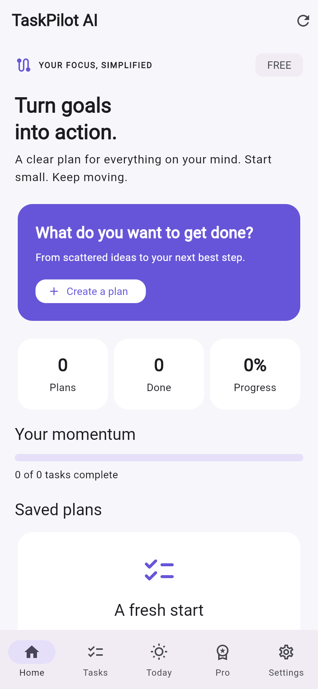
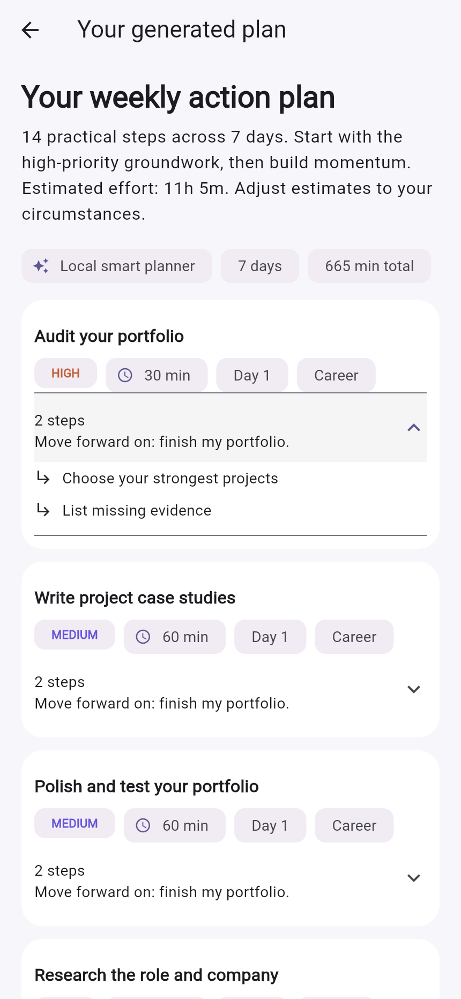

# TaskPilot AI
**Turn goals into action.** A Flutter productivity app that transforms messy goals into tasks, subtasks, priorities, time estimates and a daily plan—with no paid AI API.

Built by Abu Hurrairah for a hackathon demo. This repository implements the app and documentation; submission eligibility and event dates must be checked against the organizer's rules.

## Problem and solution
A goal like “finish my portfolio and prepare for an interview” hides dozens of small decisions. TaskPilot gives it a concrete sequence, then makes the next step visible. Planning works entirely through a deterministic local Python provider by default. Optional Ollama adds a local LLM without becoming a dependency.

## Implemented features
- Splash/loading and first-launch onboarding; no authentication.
- Goal entry, demo prompt, 1–30 day horizon, structured plan preview and explicit save.
- Seven category templates including interviews, exams, projects, applications, fitness, content and general goals; a dedicated portfolio template.
- Priority labels, estimated minutes, day allocation, expandable subtasks and category labels.
- SQLite persistence, task completion/incompletion, title editing, plan deletion, search/filter, completion progress.
- Today view anchored to the device's local date; includes unfinished overdue tasks.
- Pro time-budget view and completion/remaining-effort insights.
- Material 3, dark mode, loading/error/empty states, read-only cached plans offline.
- RevenueCat SDK configuration, CustomerInfo listener, current offering packages, real SDK purchase call, restore and entitlement checks.
- Explicit no-key Pro preview: **not a purchase and not a RevenueCat entitlement**.

## Screenshots
Nine actual screenshots from the running Flutter web release and local FastAPI backend, including onboarding, Home, goal input, plan, Today, task progress and labelled Pro demo screens. These are web captures, not Android emulator or RevenueCat transaction evidence.




## Architecture and tech stack
Flutter/Dart + Material 3 → HTTP JSON → FastAPI/Pydantic → provider abstraction → SQLite.
Mobile settings and a read-only plan cache use shared_preferences. RevenueCat purchases_flutter handles Android/iOS billing. No paid hosting, database, model API or assets. See [ARCHITECTURE.md](ARCHITECTURE.md).

## Prerequisites on Windows
1. Install Python 3.11+ from python.org, selecting **Add Python to PATH**.
2. Install the Flutter stable SDK and add its `bin` folder to PATH. Use current stable; this project was generated and checked with Flutter 3.47.5 / Dart 3.13.4. Run `flutter upgrade` if your SDK is older.
3. Install Android Studio, Android SDK and an Android emulator, or enable USB debugging on your Android phone.
4. Run `flutter doctor` and complete Android SDK licenses with `flutter doctor --android-licenses`.
No credentials are required for the core app. For a real test purchase, create a free RevenueCat account and obtain a **public Test Store SDK key**.

## Immediate browser demo — no Flutter installation needed
On Windows, you can double-click `run-backend.bat`, then `run-web-preview.bat`, and open the URL shown. For the mobile app use `run-mobile.bat` after installing Flutter/Android SDK and editing mobile/config.json. Equivalent exact terminal commands follow.
The ZIP includes a prebuilt copy of the actual Flutter web app in `preview/web`. Start the backend as shown below, then open a second PowerShell terminal from the project root:
```powershell
py -3 -m http.server 8080 --bind 127.0.0.1 --directory preview/web
```
Open http://127.0.0.1:8080 in Chrome or Edge. This preview connects to http://127.0.0.1:8000 and uses explicit no-purchase demo mode. It includes the real planning/save/task workflow, not a mockup. Android/iOS are required for RevenueCat Test Store purchases. This bundled build is a convenience artifact; future source edits require rebuilding Flutter web.

## Fastest Windows run: two PowerShell terminals
Extract the ZIP and open the `taskpilot-ai` folder. Avoid a cloud-synced working folder for Android build speed.

**Terminal 1 — backend:**
```powershell
cd backend
py -3 -m venv .venv
.\.venv\Scripts\python.exe -m pip install -r requirements.txt
Copy-Item .env.example .env
.\.venv\Scripts\python.exe -m uvicorn app.main:app --host 0.0.0.0 --port 8000 --reload
```
Open http://127.0.0.1:8000/health and http://127.0.0.1:8000/docs.
These commands do not require PowerShell script execution-policy changes or venv activation.

**Terminal 2 — Flutter on Android emulator:**
```powershell
cd mobile
Copy-Item config.example.json config.json
flutter pub get
flutter devices
flutter run --dart-define-from-file=config.json
```
The bundled Android project uses `com.taskpilot.taskpilot_ai`. The default URL `http://10.0.2.2:8000` is Android emulator → Windows host.

**Physical Android via USB (fastest option):**
```powershell
adb reverse tcp:8000 tcp:8000
flutter run --dart-define=API_BASE_URL=http://127.0.0.1:8000
```
Add `--dart-define=REVENUECAT_TEST_KEY=YOUR_PUBLIC_TEST_KEY` to test billing. `adb` is in Android SDK platform-tools; add that directory to PATH if needed. USB reverse avoids Windows LAN/firewall issues.

**Physical Android over Wi-Fi:** replace API_BASE_URL in config.json with `http://YOUR_PC_LAN_IP:8000`; use `ipconfig` to find it, keep both devices on the same network, and allow Python through Windows Firewall on **Private** networks only. Do not expose this unauthenticated demo API to the internet.

**Web UI preview:**
```powershell
flutter run -d chrome --web-port=8080 --dart-define=API_BASE_URL=http://127.0.0.1:8000
```
Web deliberately uses no-purchase demo mode. Test Store purchases should be demonstrated on Android/iOS.

## Backend on macOS/Linux
```bash
cd backend
python3 -m venv .venv
source .venv/bin/activate
pip install -r requirements.txt
cp .env.example .env
uvicorn app.main:app --host 0.0.0.0 --port 8000 --reload
```
For iOS on a Mac, generate the iOS runner with `flutter create --platforms=ios .` inside mobile, set deployment target ≥13.0, and set API_BASE_URL to the reachable backend. iOS has not been device-tested. Android is the primary target.

## AI architecture
`AIProvider` has local and Ollama implementations. The local planner normalizes text, splits coordinated action goals, selects keyword templates, preserves task order and spreads estimated effort across the requested horizon. Output passes Pydantic validation.
Optional local LLM:
```powershell
ollama pull llama3.2:3b
ollama serve
```
Set `AI_PROVIDER=ollama` in backend/.env and restart FastAPI. Goal text is sent to your configured Ollama endpoint. A connection failure, timeout, invalid JSON or invalid schedule causes a local fallback. The response identifies the actual provider. The app does not claim the default rules are a neural model. Ollama requires sufficient local RAM and disk but no paid service.

## Free vs Pro / RevenueCat
| Feature | Free | Pro |
|---|---|---|
| Successful plan generations | 3 per app installation | Unlimited |
| Local subtasks | 2 per task | 3 per task |
| Basic priorities, task management, Today | Yes | Yes |
| Priority-sorted daily time-budget selection | No | Yes |
| Completion and remaining-effort insights | Basic progress | Detailed view |

The entitlement is `taskpilot_pro`. Gates live in `AppState` and `RevenueCatService`. No key: explicit DEMO MODE and a session-only Pro preview toggle. With a key: only active RevenueCat CustomerInfo unlocks Pro; failed/cancelled purchases never unlock it. Offering prices come from RevenueCat rather than hardcoded amounts. See [REVENUECAT_SETUP.md](REVENUECAT_SETUP.md).

## API endpoints
| Method | Path | Purpose |
|---|---|---|
| GET | /health | Health check |
| POST | /api/plans/generate | Generate validated unsaved draft |
| POST | /api/plans | Save draft with source goal and local start date |
| GET | /api/plans | List saved plans |
| GET | /api/plans/{id} | Get plan |
| DELETE | /api/plans/{id} | Delete plan and tasks |
| PATCH | /api/tasks/{id} | Complete/uncomplete, edit title or priority |

Example: `{"goal":"Prepare for an AI engineering interview in 3 days","available_days":3,"advanced":false}`. Open `/docs` for interactive requests and schemas. Inputs are limited to 3,000 characters and 1–30 days.

## Testing
```powershell
cd backend
.\.venv\Scripts\python.exe -m pytest -q
.\.venv\Scripts\python.exe -m compileall -q app
cd ..\mobile
flutter pub get
flutter analyze
flutter test
```
See [docs/TEST_RESULTS.md](docs/TEST_RESULTS.md) for the checks actually performed in the build environment. A native Android build and RevenueCat transaction require your local SDK/device and Test Store key.

## Privacy, security and production changes
No secrets are included. `.env.example` and config.example.json are templates; personal configs are gitignored. Public RevenueCat SDK keys belong in the client; secret RevenueCat API keys never do. CORS allows only the local web origins configured in `.env`. HTTP cleartext is enabled for the Android local demo.

This API is for one local demo user. There is no authentication, user isolation, server-enforced quota or server-side entitlement verification. Mobile gates are explainable demo logic, not tamper-resistant production billing enforcement. Before public deployment add authentication, HTTPS, authorization, rate limits, migrations/backups, server-side RevenueCat entitlement validation, and a real privacy policy. Do not collect sensitive goals in this demo.

## Limitations / future work
- Local plans use heuristics; time estimates and categories may need adjustment. No calendar integration, reminders, background scheduler or sync across users.
- Three free generations are counted locally and reset after app data is cleared. Pro preview is intentionally session-only.
- Offline cache is read-only; generation and task mutations require the backend.
- Subtasks are displayed as a breakdown, not independently checkable records. Individual task deletion and in-place regeneration are not included; delete a plan or generate a new one instead.
- Pro's daily budget selection is a simple priority-first fit, not a learned personalization model. It may omit a task larger than the budget.
- No production subscription launch, webhook backend, published store listing or deployment.
- Optional Ollama has bounded waits and may fall back on low-end hardware.

Next: independent subtask completion, calendar blocks, reminders, richer local templates and secure account-based entitlement enforcement.
License: MIT.
